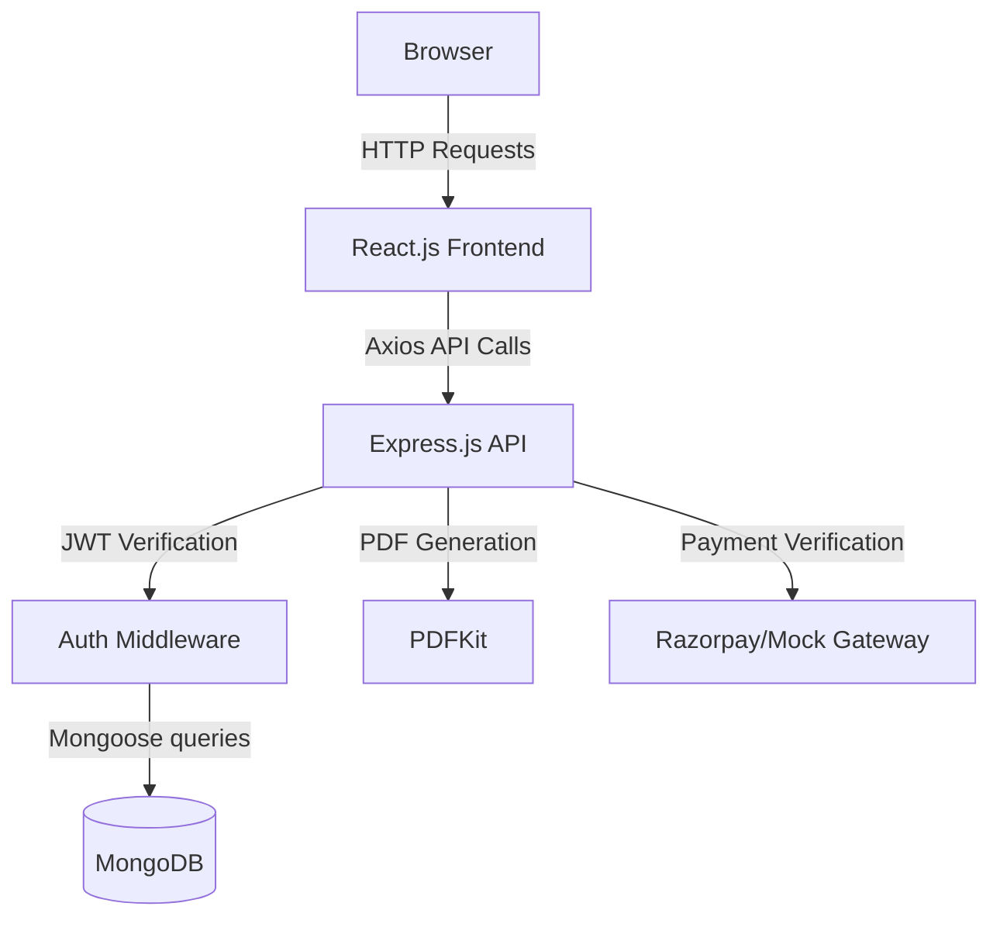

# Rail Yatra ⭐

> **Experience luxury and speed with India's next-generation train booking system.**

## Table of Contents
- [About the Project](#about-the-project)
- [Features](#features)
- [Tech Stack](#tech-stack)
- [Architecture Diagram](#architecture-diagram)
- [Project Structure](#project-structure)
- [Installation](#installation)
- [Running the Project](#running-the-project)
- [Environment Variables](#environment-variables)
- [API Documentation](#api-documentation)
- [Database Schema](#database-schema)
- [Screenshots](#screenshots)
- [Deployment](#deployment)
- [Learning Outcomes](#learning-outcomes)
- [Contributing](#contributing)
- [License](#license)
- [Author](#author)

---

## About the Project
**Why we built it:** 
Traditional train booking platforms can often be clunky, slow, and lack modern UI/UX features. Rail Yatra was built to solve this by providing a hyper-fast, seamless, and visually stunning train reservation experience.

**What problem it solves:**
It solves the complexity of segment-based seat allocation, live train tracking, and secure payment processing. By bringing all these elements under one premium UI, users don't have to guess seat availability or struggle with complex booking flows.

**Who can use it:**
- **Passengers:** Looking to quickly search, book, and manage their train travel across India.
- **Administrators:** Needing a unified dashboard to manage trains, routes, user bookings, and system analytics.

---

## Features
- ✔ **User Authentication**
- ✔ **JWT Login & Secure Hashing**
- ✔ **Role Based Access (Admin/User)**
- ✔ **Complex Segment-Based Seat Allocation**
- ✔ **Live GPS Train Tracking Simulation**
- ✔ **Dynamic PDF Ticket Generation**
- ✔ **Interactive Dashboard & Booking History**
- ✔ **Automated Mock Payment Gateway / Razorpay Integration**
- ✔ **Search & Filtering (by Station, Date, Class)**
- ✔ **Cancel & Refund Management**
- ✔ **Responsive, Mobile-first Premium Design**

---

## Tech Stack

**Frontend**
- React.js
- Vite
- Tailwind CSS
- Lucide React (Icons)
- React Router DOM
- Axios

**Backend**
- Node.js
- Express.js
- PDFKit (Ticket Generation)

**Database**
- MongoDB
- Mongoose

**Authentication**
- JSON Web Tokens (JWT)
- bcrypt.js

**DevOps & Deployment**
- Vercel (Frontend)
- Render (Backend)
- MongoDB Atlas (Cloud DB)

**Tools**
- Git & GitHub
- VS Code
- Postman

---

## Architecture Diagram



---

## Project Structure

```text
rail-yatra/
├── backend/
│   ├── scripts/          # DB Seeding Scripts
│   ├── src/
│   │   ├── config/       # DB Connection & Configs
│   │   ├── controllers/  # API Logic
│   │   ├── middleware/   # JWT Auth & Error Handling
│   │   ├── models/       # Mongoose Schemas
│   │   ├── routes/       # Express Route Definitions
│   │   ├── utils/        # Mailer, PDF Generators
│   │   └── index.js      # Server Entry Point
│   ├── package.json
│   └── .env.example
├── frontend/
│   ├── public/           # Static Assets
│   ├── src/
│   │   ├── components/   # Reusable UI Components
│   │   ├── context/      # React Context (Auth, Booking)
│   │   ├── pages/        # Route Pages (Dashboard, Search, etc.)
│   │   ├── App.jsx       # Main Router
│   │   └── index.css     # Tailwind & Custom CSS
│   ├── package.json
│   ├── tailwind.config.js
│   └── vite.config.js
└── README.md
```

---

## Installation

```bash
# Clone the repository
git clone https://github.com/yourusername/rail-yatra.git
cd rail-yatra

# Install Backend Dependencies
cd backend
npm install

# Install Frontend Dependencies
cd ../frontend
npm install
```

---

## Running the Project

**1. Start the Backend:**
```bash
cd backend
npm run dev
```
*Backend runs on http://localhost:5000*

**2. Start the Frontend:**
```bash
cd frontend
npm run dev
```
*Frontend runs on http://localhost:5173*

---

## Environment Variables

Never upload your `.env` file to version control. Create a `.env` in the `backend` folder:

```env
PORT=5000
MONGODB_URI=mongodb://127.0.0.1:27017/train_booking
JWT_SECRET=your_super_secret_jwt_key
RAZORPAY_KEY_ID=optional_live_key
RAZORPAY_KEY_SECRET=optional_live_secret
SMTP_HOST=smtp.gmail.com
SMTP_PORT=587
SMTP_USER=your_email@gmail.com
SMTP_PASS=your_app_password
FRONTEND_URL=http://localhost:5173
```

---

## API Documentation

### Auth
- `POST /api/auth/register` - Register a new user
- `POST /api/auth/login` - Authenticate user & get token
- `GET /api/auth/profile` - Get logged-in user profile

### Trains
- `GET /api/trains/search?from=NDLS&to=SBC&date=2026-07-16` - Search available trains
- `GET /api/trains/stations/autocomplete?query=Del` - Search stations
- `GET /api/trains/:id/route` - Get train route stops

### Bookings
- `POST /api/bookings/create` - Create a pending order
- `POST /api/bookings/verify` - Verify payment and allocate seats
- `GET /api/bookings/history` - Get user's bookings
- `GET /api/bookings/:id/download` - Download PDF Ticket
- `POST /api/bookings/:id/cancel` - Cancel ticket and process refund

---

## Database Schema

**Collections:**
- **Users**: `_id`, `name`, `email`, `password`, `phone`, `role`, `savedTravellers`
- **Stations**: `_id`, `code`, `name`, `state`, `zone`
- **Trains**: `_id`, `trainNumber`, `name`, `source`, `destination`, `classes`, `baseFare`, `runsOn`
- **Routes**: `_id`, `train`, `stops` (`station`, `arrivalTime`, `departureTime`, `distanceKm`, `dayNumber`)
- **Bookings**: `_id`, `user`, `train`, `pnr`, `date`, `seatClass`, `passengers`, `totalFare`, `status`, `paymentId`
- **Reviews**: `_id`, `user`, `train`, `rating`, `comment`

---

## Screenshots

*(Upload and replace these links with actual image URLs once pushed to GitHub)*

- **Landing Page**: ``
- **Search Results**: ``
- **Secure Checkout / Payment Gateway**: ``
- **User Dashboard**: ``
- **Live Train Tracker**: ``
- **PDF Ticket Generation**: ``

---

## Deployment
- **Frontend**: Deployed on [Vercel](https://vercel.com)
- **Backend**: Deployed on [Render](https://render.com)
- **Database**: Hosted on [MongoDB Atlas](https://www.mongodb.com/cloud/atlas)

*(Refer to `deployment_guide.md` for complete step-by-step instructions).*

---

## Learning Outcomes
- Implementing complex business logic for segment-based seat allocation.
- Understanding and integrating simulated Payment Gateways.
- Designing a premium, highly responsive user interface using Tailwind CSS.
- Generating binary files (PDFs) dynamically on the backend and serving them to the client.

---

## Contributing
Contributions are always welcome! Please fork this repository and submit a pull request for any enhancements.

---

## License
Distributed under the MIT License. See `LICENSE` for more information.

---

## Author
**Prajwal**
- GitHub: [@Prajwal01-oss](https://github.com/Prajwal01-oss)
