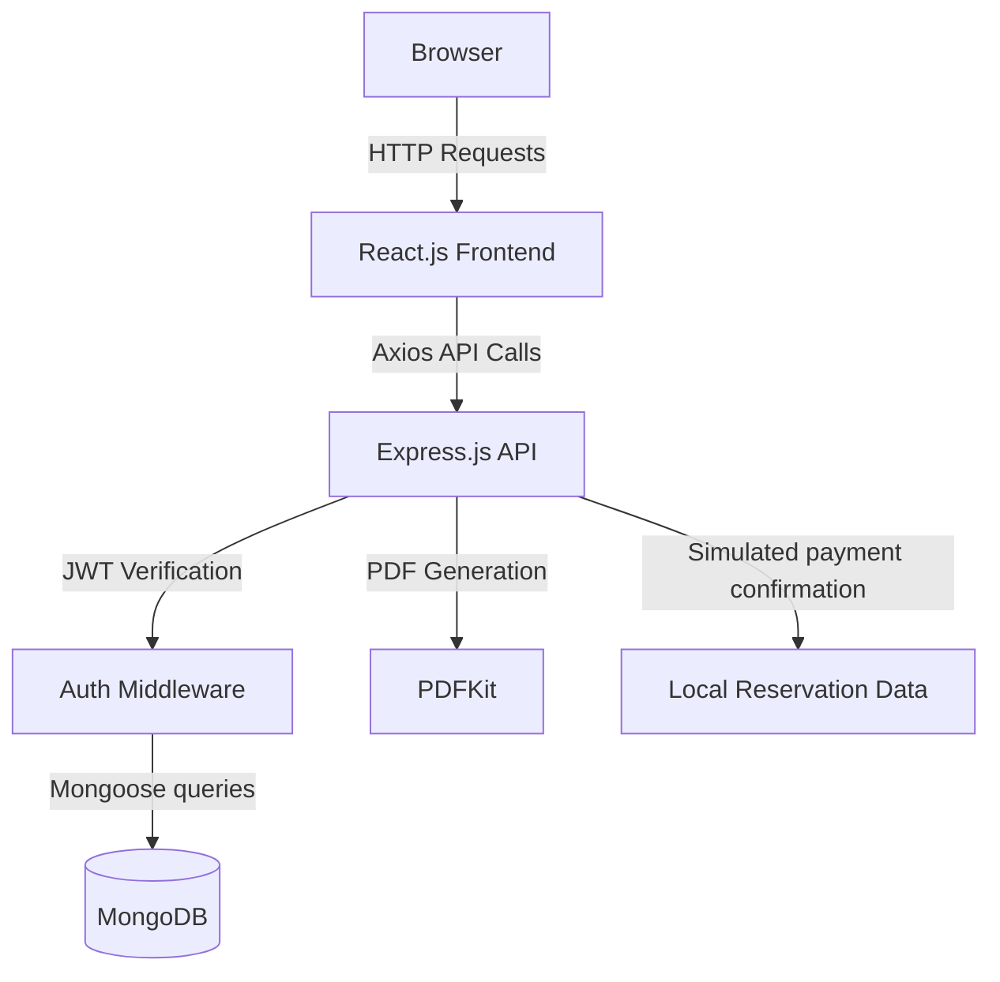

# The One Rail ⭐

> **Experience luxury and speed with India's next-generation train booking system.**

## Table of Contents
- [About the Project](#about-the-project)
- [Features](#features)
- [Tech Stack](#tech-stack)
- [Architecture Diagram](#architecture-diagram)
- [Project Structure](#project-structure)
- [Installation](#installation)
- [Running the Project](#running-the-project)
- [Environment Variables](#environment-variables)
- [API Documentation](#api-documentation)
- [Database Schema](#database-schema)
- [Screenshots](#screenshots)
- [Deployment](#deployment)
- [Learning Outcomes](#learning-outcomes)
- [Contributing](#contributing)
- [License](#license)
- [Author](#author)

---

## About the Project
**Why we built it:** 
The One Rail is a modern train reservation demonstration with sample bookings and optional external timetable data.

**What problem it solves:**
It solves the complexity of segment-based seat allocation, live train tracking, and secure payment processing. By bringing all these elements under one premium UI, users don't have to guess seat availability or struggle with complex booking flows.

**Who can use it:**
- **Passengers:** Looking to quickly search, book, and manage their train travel across India.
- **Administrators:** Needing a unified dashboard to manage trains, routes, user bookings, and system analytics.

---

## Features
- ✔ **User Authentication**
- ✔ **JWT Login & Secure Hashing**
- ✔ **Role Based Access (Admin/User)**
- ✔ **User-Selected Coach and Seat Reservations with Temporary Holds**
- ✔ **Live GPS Train Tracking Simulation**
- ✔ **Dynamic PDF Ticket Generation**
- ✔ **Interactive Dashboard & Booking History**
- ✔ **Simulated Checkout, PNR, Availability, and Fare Estimates**
- ✔ **Search & Filtering (by Station, Date, Class)**
- ✔ **Cancel & Refund Management**
- ✔ **Responsive, Mobile-first Premium Design**

---

## Tech Stack

**Frontend**
- React.js
- Vite
- Tailwind CSS
- Lucide React (Icons)
- React Router DOM
- Axios

**Backend**
- Node.js
- Express.js
- PDFKit (Ticket Generation)

**Database**
- MongoDB
- Mongoose

**Authentication**
- JSON Web Tokens (JWT)
- bcrypt.js

**DevOps & Deployment**
- Vercel (Frontend)
- Render (Backend)
- MongoDB Atlas (Cloud DB)

**Tools**
- Git & GitHub
- VS Code
- Postman

---

## Architecture Diagram



---

## Project Structure

```text
rail-yatra/
├── backend/
│   ├── scripts/          # DB Seeding Scripts
│   ├── src/
│   │   ├── config/       # DB Connection & Configs
│   │   ├── controllers/  # API Logic
│   │   ├── middleware/   # JWT Auth & Error Handling
│   │   ├── models/       # Mongoose Schemas
│   │   ├── routes/       # Express Route Definitions
│   │   ├── utils/        # Mailer, PDF Generators
│   │   └── index.js      # Server Entry Point
│   ├── package.json
│   └── .env.example
├── frontend/
│   ├── public/           # Static Assets
│   ├── src/
│   │   ├── components/   # Reusable UI Components
│   │   ├── context/      # React Context (Auth, Booking)
│   │   ├── pages/        # Route Pages (Dashboard, Search, etc.)
│   │   ├── App.jsx       # Main Router
│   │   └── index.css     # Tailwind & Custom CSS
│   ├── package.json
│   ├── tailwind.config.js
│   └── vite.config.js
└── README.md
```

---

## Installation

```bash
# Clone the repository
git clone https://github.com/yourusername/rail-yatra.git
cd rail-yatra

# Install Backend Dependencies
cd backend
npm install

# Install Frontend Dependencies
cd ../frontend
npm install
```

---

## Testing

Run the isolated unit suites from each application folder with `npm test`. The booking smoke check exercises registration, login, sample search, concurrent seat holds, confirmation, PNR, PDF download, cancellation, and seat release. It requires a dedicated MongoDB database whose name ends in `_test`, plus an API instance connected to that same database:

```env
MONGODB_TEST_URI=mongodb://localhost:27017/the_one_rail_test
TEST_API_BASE_URL=http://localhost:5000/api
```

Set the backend API instance’s `MONGODB_URI` to the same test-only URI before running `npm run test:smoke`. The script refuses a database name without the `_test` suffix and never uses the normal `MONGODB_URI` as its cleanup connection.

---

## Running the Project

**1. Start the Backend:**
```bash
cd backend
npm run dev
```
*Backend runs on http://localhost:5000*

**2. Start the Frontend:**
```bash
cd frontend
npm run dev
```
*Frontend runs on http://localhost:5173*

**Add sample train data safely:**
```bash
cd backend
npm run seed:sample
```
This command inserts only missing sample stations, trains, and routes. It does not replace or delete existing records. `npm run seed` is the legacy full reset script and deletes existing collections; do not use it when you need to preserve data.

With the default sample provider, train schedules, fares, seats, payments, and PNRs are simulated information, not verified live railway or IRCTC data. External timetable mode is described below; it does not make seats, fares, payments, or PNRs real. The generated PDF is a project reservation and is not valid for travel. Seat inventory is local application data, separate from the timetable provider.

---

## Environment Variables

Never upload your `.env` file to version control. Create a `.env` in the `backend` folder:

```env
PORT=5000
MONGODB_URI=mongodb://127.0.0.1:27017/train_booking
JWT_SECRET=your_super_secret_jwt_key
SEAT_HOLD_MINUTES=8
SMTP_HOST=smtp.gmail.com
SMTP_PORT=587
SMTP_USER=your_email@gmail.com
SMTP_PASS=your_app_password
FRONTEND_URL=http://localhost:5173
```

Optional frontend setting in `frontend/.env`:
```env
VITE_SENIOR_CITIZEN_AGE=60
```

---

## API Documentation

### Auth
- `POST /api/auth/register` - Register a new user
- `POST /api/auth/login` - Authenticate user & get token
- `GET /api/auth/profile` - Get logged-in user profile

### Trains
- `GET /api/trains/search?from=NDLS&to=SBC&date=2026-07-16` - Search available trains
- `GET /api/trains/stations/autocomplete?query=Del` - Search stations
- `GET /api/trains/:id/route` - Get train route stops

### Bookings
- `POST /api/bookings/create` - Create a pending order
- `GET /api/bookings/coaches?trainId=...&date=YYYY-MM-DD&seatClass=SL` - List local sample coaches
- `GET /api/bookings/coaches/:coach/seats?...` - View a coach layout
- `POST /api/bookings/hold` - Temporarily hold selected seats (authenticated)
- `POST /api/bookings/verify` - Confirm a simulated payment and the exact held seats
- `GET /api/bookings/history` - Get user's bookings
- `GET /api/bookings/:id/download` - Download PDF Ticket
- `POST /api/bookings/:id/cancel` - Cancel ticket and process refund

---

## Database Schema

**Collections:**
- **Users**: `_id`, `name`, `email`, `password`, `phone`, `role`, `savedTravellers`
- **Stations**: `_id`, `code`, `name`, `state`, `zone`
- **Trains**: `_id`, `trainNumber`, `name`, `source`, `destination`, `classes`, `coachComposition`, `baseFare`, `runsOn`, `dataSource`
- **Routes**: `_id`, `train`, `stops` (`station`, `arrivalTime`, `departureTime`, `distanceKm`, `dayNumber`)
- **Bookings**: `_id`, `user`, `train`, `pnr`, `date`, `seatClass`, `passengers`, `totalFare`, `status`, `paymentId`
- **SeatInventories**: unique train/date/class/coach/seat entries with AVAILABLE, HELD, and BOOKED states
- **Reviews**: `_id`, `user`, `train`, `rating`, `comment`

---

## Screenshots

*(Upload and replace these links with actual image URLs once pushed to GitHub)*

- **Landing Page**: ``
- **Search Results**: ``
- **Secure Checkout / Payment Gateway**: ``
- **User Dashboard**: ``
- **Live Train Tracker**: ``
- **PDF Ticket Generation**: ``

---

## Deployment
- **Frontend**: Deployed on [Vercel](https://vercel.com)
- **Backend**: Deployed on [Render](https://render.com)
- **Database**: Hosted on [MongoDB Atlas](https://www.mongodb.com/cloud/atlas)

*(Refer to `deployment_guide.md` for complete step-by-step instructions).*

## Railway timetable data provider

The app defaults to its clearly labelled sample timetable. To search externally supplied Indian train schedules, set these values in the **backend** environment:

```env
TRAIN_DATA_PROVIDER=railradar
RAILRADAR_API_KEY=your_server_side_provider_key
```

The external mode uses the RailRadar station directory and trains-between-stations timetable API; `GET /api/trains/directory` exposes its reserved-train directory and `GET /api/trains/external/:trainNumber/schedule` returns an individual schedule. Keep the key on the server and never put it in a `VITE_` variable. External results are read-only timetable information: class, fare, and live seat availability are not inferred, and demo booking stays disabled for those results. Local sample train data and reservation inventory continue to work when `TRAIN_DATA_PROVIDER` is unset. The provider's schedule data is third-party information and should be checked against official railway sources before travel.

---

## Learning Outcomes
- Implementing complex business logic for segment-based seat allocation.
- Understanding and integrating simulated Payment Gateways.
- Designing a premium, highly responsive user interface using Tailwind CSS.
- Generating binary files (PDFs) dynamically on the backend and serving them to the client.

---

## Contributing
Contributions are always welcome! Please fork this repository and submit a pull request for any enhancements.

---

## License
Distributed under the MIT License. See `LICENSE` for more information.

---

## Author
**Prajwal**
- GitHub: [@Prajwal01-oss](https://github.com/Prajwal01-oss)
